<picture>
  <source media="(prefers-color-scheme: dark)" srcset="assets/hero-dark.svg">
  
</picture>

## 01 · OPERATOR

**yannicksong0106**，屎山代码生产者。

正经活干得不多，基本是想起一出是一出。  
所有玩意都是在一堆 bug 上运行的。  
bug 什么的你也别管，能 work 就行。  
有人用挺好，没人用我自己用。  
更新？更新是啥意思，我听都没听过。

ENGLISH

**yannicksong0106** — a shit-mountain code producer.

I don't do much serious work; I get one idea and run with it.  
Everything here runs on a pile of bugs.  
Don't worry about them — if it works, it works.  
Nice if someone uses it, fine if it's just me.  
Updates? What's an update? Never heard of it.

## 02 · MODULE RACK

自己天天在用的几个。状态灯：`●` 在跑 · `◐` 半死不活 · `○` 挖坑没填。

|  | MODULE | 说明 | LANG | ★ |
|:--:|---|---|---|--:|
| ● | **[dsh-550c-boot](https://github.com/yannicksong0106/dsh-550c-boot)** | 开机动画，首帧由宿主半边注入，加载卡片不露脸 | JS | 237 |
| ● | **[dsh-550c-skin](https://github.com/yannicksong0106/dsh-550c-skin)** | 把 DSH 刷成 550C 控制台：四套磷光配色、扫描线、读数栏 | JS | 11 |
| ◐ | **[dsh-community-plugins](https://github.com/yannicksong0106/dsh-community-plugins)** | 插件索引，community.json 是商店的唯一数据源 | TS | — |
| ○ | **[awesome-dsh-plugin](https://github.com/yannicksong0106/awesome-dsh-plugin)** | DeepSeek Harness 插件精选列表 | JS | — |

## 03 · SUBSYSTEM

给 Agent 用的小玩意，还有几块练手的板子。

|  | MODULE | 说明 | LANG | ★ |
|:--:|---|---|---|--:|
| ● | **[qq-email-skill](https://github.com/yannicksong0106/qq-email-skill)** | 让 Agent 自己收发邮件：IMAP / SMTP | PY | 3 |
| ● | **[hutao-speaker](https://github.com/yannicksong0106/hutao-speaker)** | 胡桃人格，让 Agent 变成往生堂第七十七代堂主 | — | 1 |
| ○ | **[cpp-practice](https://github.com/yannicksong0106/cpp-practice)** | 上课写的 C++ 练习，留个档 | C++ | — |

## 04 · SIGNAL

有事说事，或者单纯来催更：

[GitHub](https://github.com/yannicksong0106)　·　[Issues](https://github.com/yannicksong0106/yannicksong0106/issues)

数字是 GitHub Actions 每天重算的，不是手写。卡片是自己画的 SVG，跟着系统主题走。
